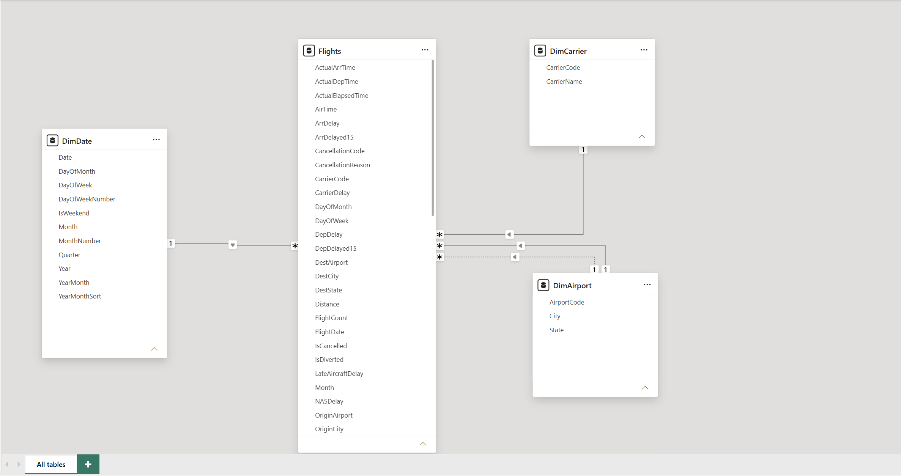
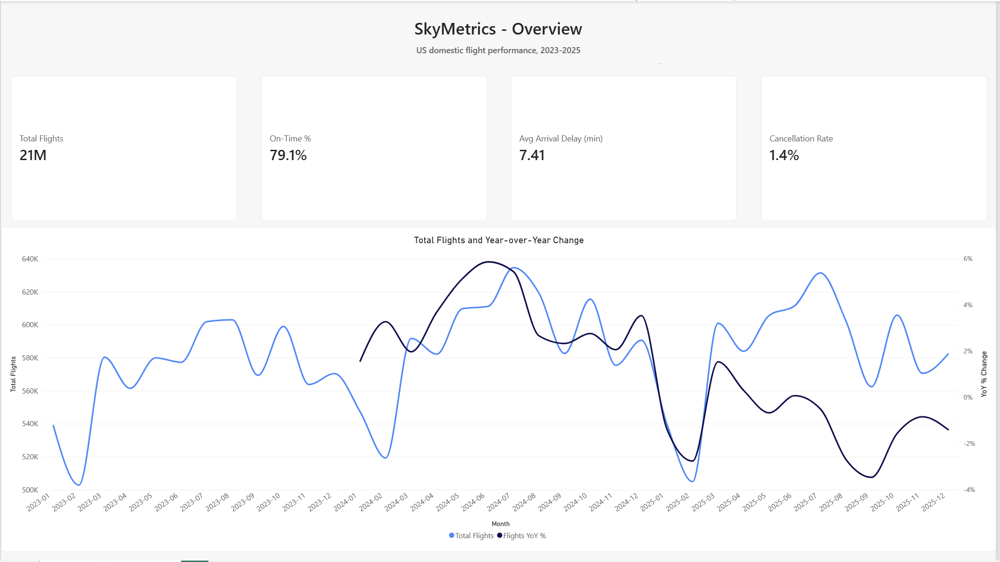
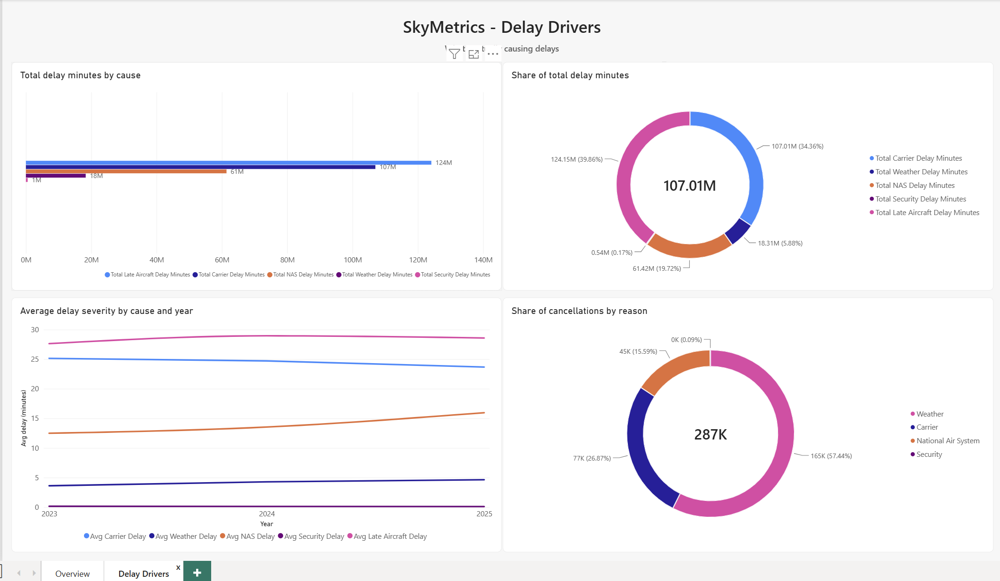
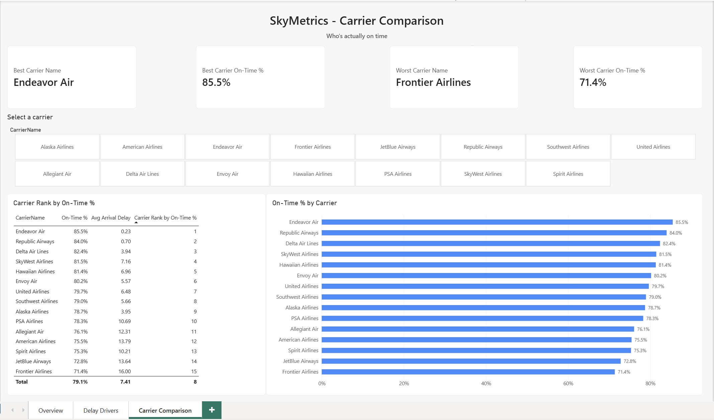
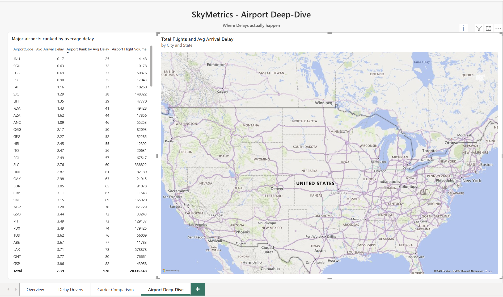
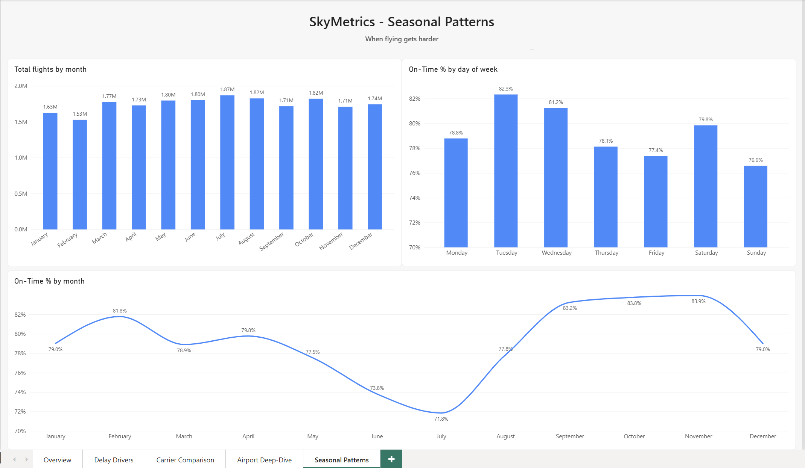

# SkyMetrics

A Power BI portfolio project analyzing US domestic airline on-time performance:
data cleaning, star-schema modeling, DAX measures, and dashboard storytelling.
Companion to [SkyPulse](https://github.com/hashir-muhmd/airline-delay-intelligence),
showing BI skills on a large, messy, real-world dataset rather than a live pipeline.

## Overview

- **Source**: US Bureau of Transportation Statistics (BTS), Reporting Carrier On-Time Performance
- **Scope**: US domestic flights, 2023-2025 (36 monthly files)
- **Scale**: ~20.9 million flight records
- **Tools**: Power Query (M), Power BI data modeling, DAX, Python (verification)

## Why this scope

- **2023-2025, not 2020-2022**: avoids COVID-era disruption skewing delay and cancellation metrics
- **Full years only, not partial 2026**: keeps year-over-year comparisons fair
- **US domestic only**: BTS does not cover international carriers such as Qatar Airways, Emirates, or Singapore Airlines

## Data cleaning

Full reasoning is in [`docs/data-cleaning-log.md`](docs/data-cleaning-log.md). Highlights:

- Combined 36 monthly CSVs into one fact table via Power Query
- Renamed BTS's raw `SCREAMING_SNAKE_CASE` columns to readable names
- Fixed data types, dropped unused columns, derived `DayOfWeek` (missing from BTS's export)
- Documented a key null pattern: the five delay-cause columns are null for ~79% of rows by design (only populated when a flight is delayed 15+ minutes), not because data is missing
- Exported the M-code to [`powerquery/m-scripts/`](powerquery/m-scripts/) as a diffable record of every step

## Data model

Star schema: fact table `Flights` (~20.9M rows) with dimensions `DimDate` (marked as the date table), `DimCarrier`, and `DimAirport`.

`DimAirport` relates to `Flights` twice: via `OriginAirport` (active) and `DestAirport` (inactive, activated per-measure with `USERELATIONSHIP()`).



## DAX measures

25 measures across five folders: Core Metrics, Delay Causes, Cancellations, Time Intelligence, Rankings. Airport rankings apply a 10,000+ flight filter so small regional airports don't distort the averages.

## Dashboard pages

1. **Overview**: headline KPIs and a year-over-year trend line
2. **Delay Drivers**: delay minutes by cause, severity trend by year, cancellation reasons
3. **Carrier Comparison**: ranked table, on-time % bar chart, carrier slicer, best/worst KPI cards
4. **Airport Deep-dive**: major-airport ranking table with a geographic map
5. **Seasonal Patterns**: flights by month, on-time % by day of week and by month

### Overview


### Delay Drivers


### Carrier Comparison


### Airport Deep-dive


### Seasonal Patterns


## Key findings

Full write-up in [`docs/findings.md`](docs/findings.md). Highlights:

- Late Aircraft and Carrier delays dominate delay-minutes (74% combined), but Weather dominates cancellations (57%)
- Carrier on-time performance spans 14.1 points, from Endeavor Air (85.5%) to Frontier Airlines (71.4%)
- NAS (air traffic system) delay rose ~28% from 2023 to 2025 while carrier delay modestly improved
- On-time performance swings more by month (71.8% in July to 83.9% in November) than flight volume does; Sunday and Friday are the worst days to fly
- Naive airport rankings are dominated by small regional airports, so a flight-volume filter is needed

## Repository structure

```
skymetrics/
├── data/raw/              # source CSVs (gitignored)
├── docs/                  # cleaning log, findings, data model diagram
├── pbix/                  # Power BI file (gitignored)
├── powerquery/m-scripts/  # exported M-code
├── screenshots/dashboard-pages/
└── scripts/               # Python verification scripts
```

## Verification

Python scripts in [`scripts/`](scripts/) confirm row counts, year/month consistency, and column-schema consistency across all 36 source files before any modeling.